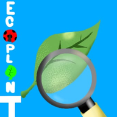

<p align="center"></p>
<h1 align="center">Ecoplant</h1>
<p align="center"><strong>Cada folha, uma história.</strong><br>Um jardim organizado. Um olhar atento. Registros que acompanham o tempo.</p>
<p align="center"><a href="https://perabru.github.io/ecoplant/">Abrir aplicativo</a> · <a href="setup/README-GITHUB-PAGES.md">Publicação</a> · <a href="setup/README-FIREBASE.md">Configurar Firebase</a> · <a href="setup/Ecoplant_Regras_Para_Copiar.txt">Copiar regras do banco</a></p>

PWA em português para registrar plantas, fotografar folhas e acompanhar sua evolução. A interface usa verde floresta, ilustrações botânicas e temas claro e escuro. Funciona como site e pode ser instalado na tela inicial do Android e do iPhone.

## Começar a usar

1. Abra [Analisar planta](https://perabru.github.io/ecoplant/#scan).
2. Toque em **Analisar uma planta sem conta** para usar neste aparelho, ou entre na sua conta.
3. Envie uma foto nítida de uma folha. Se ela estiver pequena ou fora do centro, use **Ajustar enquadramento** e mantenha a folha inteira dentro da moldura.
4. Mantenha **Análise completa — espécie e saúde** e toque em **Identificar planta e avaliar saúde**.
5. Leia a avaliação, use **Salvar no histórico** e **Imprimir / PDF** quando precisar.

Na versão 1.1.0, a escolha do modo local é retomada ao recarregar e o endereço de análise é preservado. O carregamento da IA e do modelo próprio pode ser cancelado sem perder a foto. O aplicativo guarda uma cópia verificada dos arquivos públicos da IA quando o navegador permite; isso reduz novos downloads. A primeira preparação ainda requer internet, e a disponibilidade offline depende do cache e do armazenamento do navegador.

## Correções de identificação e saúde — versão 1.3.0

A análise inicial agora usa DINOv2/PlantVillage para identificar a cultura provável e avaliar a saúde da folha na mesma fotografia. O relatório mostra a identificação separada da saúde: uma incerteza sobre a doença não apaga uma cultura identificada com pontuação suficiente. A referência botânica fica visível; categorias amplas são apresentadas como grupos de espécies, sem inventar a espécie exata.

O modelo reconhece 14 culturas: tomate, batata, milho, maçã, uva, pimentão, morango, pêssego, cereja, laranja, abóbora, soja, mirtilo e framboesa. Não é um identificador botânico universal. A checagem de compatibilidade da imagem e o limiar de classificação permanecem ativos. Imagens incompatíveis continuam sem espécie e sem condição de saúde atribuídas.

O treinamento de dez classes permanece disponível em **Treinamento do projeto — 10 classes**. Ele deixou de ser o padrão porque testes com fotografias externas revelaram classificações incorretas, incluindo uma folha saudável de tomateiro rotulada como Oídio. A comparação com o modelo do projeto também consulta a identificação da planta separadamente; uma falha nessa consulta mantém a classificação já concluída e informa a ausência da identificação.

Os indicadores de saúde agora interpretam também as classes válidas do treinamento EcoPlant. Quando a soma das pontuações registradas de classes de doença ultrapassa o limiar, mas nenhuma doença isolada é suficientemente definida, a interface informa sinais de possível doença com causa ainda não definida. As pontuações não são transformadas em porcentagem de saúde.

O carregamento usa o runtime WASM correspondente à inferência local. No Teachable Machine, uma falha de WebGL permite uma tentativa real com os mesmos pesos em CPU. A atualização da PWA preserva os modelos públicos já verificados e revalida os arquivos do aplicativo. Identificação, relatório, exportação e histórico usam os campos já aceitos pelas regras do Firebase; não há migração de banco nem nova chave de API.

As verificações de funcionamento e suas limitações estão em [Validação da versão 1.3.0](notices/RELEASE_1_3_0.md).

## Modelo EcoPlant incorporado — histórico da versão 1.2.0

**Modelo EcoPlant — 10 classes** foi incorporado na versão 1.2.0 e continua disponível para comparação, selecionando **Treinamento do projeto — 10 classes**. O modelo foi treinado com o projeto de imagens fornecido para o EcoPlant e os arquivos de inferência estão no próprio site. Não é necessário importar o `.tm`, cadastrar uma chave de API ou conectar um link de modelo.

As classes preservam os nomes do projeto: `Antracnose`, `Desconhecidas`, `Ferrugem`, `Fumagina`, `Míldio`, `Oídio`, `Plantas_Saudaveis`, `Podridão_radicular`, `Vitiligo` e `Planta de plastico`. A ordem exata usada pelos pesos consta em `metadata.json`.

- `Plantas_Saudaveis` é a classe saudável configurada para este modelo.
- `Desconhecidas` e `Planta de plastico` apresentam um resultado neutro com o rótulo encontrado e sua pontuação, sem afirmar doença ou saúde.
- Os demais rótulos são apresentados como classes do modelo. A classificação de imagem não confirma diagnóstico nem determina tratamento.
- Uma probabilidade abaixo de 0,75 não define uma doença específica. A soma das classes de doença pode sustentar apenas a indicação mais ampla de sinais de possível doença; nos demais casos a avaliação permanece inconclusiva. O limiar não foi reduzido.
- O seletor mantém disponíveis **Análise completa — espécie e saúde**, **Meu modelo Teachable Machine** e o relatório de observação. Uma reanálise preserva a origem do modelo anterior.

O arquivo `.tm` continha 5.155 imagens, sem pesos treinados. A preparação retirou 322 cópias exatas dentro das classes e todas as 18 entradas dos nove grupos com rótulos contraditórios. Das 4.815 imagens únicas restantes, 4.088 foram reservadas para treinamento e 727 para avaliação externa ao treino. O conjunto de avaliação não compartilha hashes de imagens com o treino; semelhanças visuais entre fotos não foram investigadas. Essa avaliação interna não representa acurácia em campo.

O treinamento usa a biblioteca oficial do Teachable Machine com MobileNet V2, alpha 0,35, entrada RGB de 224 × 224, 50 épocas, lote 16 e taxa de aprendizagem 0,001. A primeira análise exige internet para carregar os arquivos de inferência e as bibliotecas. As fotografias são processadas no navegador; salvar um relatório mantém a opção habitual de armazenamento local ou conta Firebase.

Os detalhes e os resultados medidos estão em [Modelo EcoPlant](notices/ECOPLANT_MODEL.md). As fotografias de treinamento e de avaliação não acompanham a publicação.

## Correções da versão 1.1.1

- A ficha da planta mantém o método de análise escolhido. Um Teachable Machine conectado não é substituído silenciosamente pela IA padrão.
- Se um modelo importado deixou de estar disponível após recarregar, o aplicativo solicita reconexão. Não troca o modelo sem a escolha do usuário.
- **Ajustar enquadramento** permite ampliar, arrastar ou posicionar a foto pelos controles. A moldura deixa uma margem para o recorte central do modelo. O recorte é local, reversível e não modifica relatórios salvos.
- **Ajustar foto e tentar novamente** recupera a foto, as observações e o método de um relatório inconclusivo para uma nova análise.
- O relatório preserva a explicação de baixa confiança ou de incompatibilidade com os exemplos do modelo. A lista de culturas atendidas aparece antes de iniciar a análise.

A verificação com os pesos reais reproduziu um problema de enquadramento: as mesmas folhas de tomate e maçã, deslocadas para a borda de uma imagem horizontal, foram rejeitadas; recortes centralizados recuperaram as classes de referência sem mudar pesos ou limites de confiança. Esses testes de funcionamento não validam acurácia em campo. Fotos externas também mostraram rejeições e classificações incorretas, portanto os critérios não foram relaxados e o aplicativo não promete identificar todas as plantas ou doenças.

## Recursos

- Cadastro e login com e-mail/senha ou conta Google, recuperação e perfil.
- Firebase Realtime Database com registros separados por UID e regras de validação.
- Cadastro, edição e exclusão de plantas, fotos reduzidas no navegador e histórico.
- Câmera ao vivo com alternância frontal/traseira e alternativa de câmera nativa/galeria.
- Análise completa DINOv2/PlantVillage como padrão, com planta provável e saúde da folha; treinamento EcoPlant de dez classes disponível para comparação, sem chave de API.
- Conclusão em destaque: aparência saudável, sinais de possível doença, sinais de possível praga ou análise inconclusiva; o nome da hipótese aparece em português.
- Resultado da última foto na ficha da planta e filtros de resultado no histórico, sempre com data e sem transformar a confiança do modelo em porcentagem de saúde.
- Suporte a modelos de imagem do Teachable Machine por link hospedado, arquivos selecionados no navegador ou pasta `./my_model/` do aplicativo.
- Relatório que abre dentro do aplicativo, com foto, resultado real da IA, observações, salvamento no histórico e botão direto Imprimir / PDF.
- Relatório de observação sem IA, com sinais opcionais e registro fotográfico mesmo sem planta cadastrada.
- Rascunho do relatório preservado na aba por UID, inclusive após recarregar; nova análise não reaproveita os sinais de outra planta.
- Modo local explícito com IndexedDB, exportação JSON e consulta offline do último conteúdo carregado.
- Manifest, ícones, Service Worker e instalação Android/iOS.
- Tema claro e escuro com preferência salva, botão de semente/planta e respeito à preferência inicial do aparelho.
- Splash com planta animada e loading de sete hexágonos durante as operações reais.

## Ativar o banco

Projeto Firebase: `wizardsofthesouth-8a2dc`.

Leia [setup/README-FIREBASE.md](setup/README-FIREBASE.md). As regras completas estão em [setup/database.rules.json](setup/database.rules.json), com uma cópia em texto em [setup/Ecoplant_Regras_Para_Copiar.txt](setup/Ecoplant_Regras_Para_Copiar.txt).

Os registros usam:

| Caminho | Conteúdo |
| --- | --- |
| `ecoplant/config` | Nome e versão da estrutura |
| `ecoplant/users/UID/profile` | Perfil, preferências e link do modelo |
| `ecoplant/users/UID/plants/ID` | Dados e foto de uma planta |
| `ecoplant/users/UID/analyses/ID` | Relatório e foto de uma avaliação |

As credenciais de acesso são gerenciadas pelo Firebase Authentication. Senhas não são gravadas no Realtime Database. O aplicativo não grava registros pessoais enquanto o caminho do usuário aceitar leitura anônima.

Em um banco usado por outros aplicativos, combine as regras preservando os outros caminhos. Permissões públicas em um pai não podem ser retiradas em um filho.

Autorize `perabru.github.io` em Authentication → Configurações → Domínios autorizados. O endereço é apenas o host, sem `https://` e sem `/ecoplant/`. Se continuar utilizando a publicação anterior, mantenha também `ecoplant-bruno.perabru.chatgpt.site`.

## Gerar o relatório e usar a IA

Abra **Analisar planta**, envie uma foto e toque em **Identificar planta e avaliar saúde**. Para usar outro treinamento, altere o seletor antes de analisar. Vincular a foto a uma planta cadastrada é opcional. O relatório aparece no aplicativo; use **Salvar no histórico** para guardá-lo e **Imprimir / PDF** para exportar. Na ficha de uma planta, **Gerar relatório com esta foto** usa a imagem cadastrada; **Analisar uma nova foto** limpa o contexto anterior.

A opção **Relatório de observação — sem IA** também funciona sem marcar sinais: nesse caso, gera um registro fotográfico neutro, sem hipótese de doença ou afirmação de saúde. Falhas na IA nunca acionam essa opção silenciosamente.

### Entender a saúde da folha na IA geral

O relatório coloca a conclusão antes dos gráficos. **Aparência saudável** significa semelhança com folhas saudáveis do conjunto do modelo, restrita à foto enviada. **Sinais de possível doença** apresenta a cultura e o nome da hipótese; **Sinais de possível praga** diferencia ácaro rajado de doença. **Análise inconclusiva** não exibe uma doença nem porcentagens de confiança. Preserva o motivo da rejeição e oferece ajuste de enquadramento ou nova foto. Texto e ícones acompanham as cores verde, vermelha e neutra.

`dist/plant-health.js` mantém uma interpretação única para análise, relatório, ficha e histórico. Só aceita classes conhecidas, escores numéricos consistentes e probabilidade da classe principal a partir de 0,75. A margem mínima de 0,15 é uma verificação defensiva redundante para probabilidades normalizadas nesse limiar. Os limites são uma política conservadora do aplicativo, não precisão, sensibilidade ou desempenho em campo validados. A verificação original de imagem fora do conjunto também continua ativa.

Relatórios antigos são apresentados segundo essa política atual. O JSON exportado conserva o registro original em `report` e inclui a interpretação atual em `assessment`, com a versão da política. Nenhum campo adicional é gravado no Firebase. As culturas mirtilo, framboesa e soja têm somente classes saudáveis no treinamento; laranja e abóbora não têm classe saudável. O relatório informa essas limitações quando aplicáveis.

A opção **IA geral — 14 culturas** usa o modelo aberto [rodynaemad/plant-disease-dinov2-small](https://huggingface.co/rodynaemad/plant-disease-dinov2-small), de Rodayna Emad Mohamed, treinado no [PlantVillage](https://huggingface.co/datasets/mohanty/PlantVillage). A exportação ONNX int8 tem cerca de 24 MB e é executada por ONNX Runtime Web 1.30.0 em WebAssembly. A primeira utilização exige internet para baixar o modelo e o mecanismo de processamento; nenhuma chave ou treinamento próprio é necessário. A foto é processada no navegador. A opção de salvar mantém o armazenamento habitual do aplicativo: conta Firebase ou modo local.

**Limites:** são 38 classes de 14 culturas, aprendidas principalmente em imagens de folhas isoladas. Não é um classificador universal de plantas nem confirmação de doença. O verificador de similaridade com o treinamento pode produzir **Análise inconclusiva** para imagens fora desse conjunto; nesses casos, o relatório não apresenta uma doença nem uma porcentagem de confiança. Esse filtro não garante rejeitar toda imagem inadequada. Os valores do conjunto de teste publicados pelo autor não equivalem a desempenho em fotos de campo.

O modelo é distribuído pelo autor sob **CC BY-SA 4.0**; o backbone DINOv2 usa **Apache 2.0**. O EcoPlant mantém a atribuição e utiliza artefatos com versão e integridade verificadas. As imagens de teste funcionais do PlantVillage não são adicionadas ao site e não constituem uma avaliação independente de acurácia.

## Conectar seu Teachable Machine (opcional)

Treine um projeto de **imagem**, com pelo menos duas classes, e reserve imagens novas para avaliação. Exporte em **TensorFlow.js** e escolha uma das opções:

- **Link hospedado:** use **Fazer upload** no Teachable Machine e cole o endereço `https://teachablemachine.withgoogle.com/models/ID/` em **Perfil → Teachable Machine**.
- **Arquivos do modelo:** use a exportação para download e, em **Perfil → Teachable Machine → Arquivos do modelo**, selecione juntos `model.json`, `metadata.json` e todos os arquivos `.bin` declarados no manifesto de `model.json`. São aceitos até 32 arquivos de pesos, somando no máximo 128 MB, com os nomes originais. A seleção vale apenas para a sessão/aba e deve ser repetida após recarregar a página. Os arquivos selecionados não são enviados ao Firebase.
- **Modelo empacotado:** coloque os mesmos três arquivos em `dist/my_model/`. A fonte principal é `dist/`; execute `npm run prepare:pages` para copiá-los para `docs/my_model/`. No site, o modelo fica disponível pelo caminho relativo `./my_model/`.

Para um modelo pessoal conectado, opcionalmente informe o nome exato da classe saudável; o aplicativo confere se ela existe no modelo. A interpretação escolhida é preservada no título e no resumo de cada resultado, sem depender das configurações futuras do perfil e sem mudar o esquema do Firebase. Relatórios antigos sem essa informação continuam mostrando a classe original, sem inferir retrospectivamente a condição saudável. Previsões do Teachable Machine abaixo de 0,75 ficam inconclusivas: esse limite é uma política do aplicativo, não acurácia comprovada. O HTML de exemplo fornecido pelo Teachable Machine **não contém os pesos treinados** e não substitui os arquivos exportados.

A pasta `my_model` inclui o modelo EcoPlant de 10 classes. Sua configuração de classe saudável e classes neutras está em `ecoplant-config.json`, separada das preferências de modelos pessoais no Perfil. Para substituir o modelo empacotado, confira também essa configuração; os nomes precisam corresponder exatamente aos rótulos do novo `metadata.json`.

`npm run prepare:pages` gera `dist/model-config.js` e sua cópia publicada com a disponibilidade real do modelo. A preparação só habilita o modelo do EcoPlant quando todos os arquivos do manifesto estão presentes; um pacote parcial ou inválido interrompe a publicação.

Se um modelo configurado responder com uma falha temporária, o carregador repete as transferências de JSON e pesos até três vezes por arquivo, dentro do prazo total de 45 segundos. Para modelos hospedados no Teachable Machine, pode utilizar o destino oficial de armazenamento do mesmo modelo após uma falha de rede/servidor. Erros de permissão, arquivos inexistentes ou conteúdo inválido continuam sendo informados. A foto e as observações permanecem disponíveis para tentar novamente ou conectar os arquivos locais.

O processamento da imagem acontece no navegador. As bibliotecas e os modelos hospedados precisam ser baixados com internet. A confiança expressa a escolha entre as classes treinadas e não mede a saúde nem a gravidade de uma condição. O salvamento dos dados e relatórios mantém o fluxo atual do aplicativo: Firebase para a conta ou armazenamento do navegador no modo local.

## Instalar

- Android: Chrome → Instalar aplicativo; alternativa pelo menu de três pontos.
- iPhone: Safari → Compartilhar → Adicionar à Tela de Início.

Câmera ao vivo e Service Worker exigem um contexto seguro HTTPS. A consulta offline depende de uma abertura prévia com conexão; alterações na conta só são confirmadas após resposta do Firebase. O modo local depende do armazenamento do navegador.

## Verificação

`npm run check` verifica a sintaxe dos scripts, os contratos das regras Firebase, o carregamento/classificação/cancelamento com mocks explícitos a estabilidade dos relatórios de modelos importados, a seleção do método de análise e os limites do recorte. Essas verificações não substituem o simulador/emulador de regras nem confirmam uma publicação no Firebase.

Os testes estruturais cobrem relatórios com e sem planta cadastrada, registro sem sinais, resultado de IA inconclusivo, sanitização, botão de PDF e contratos do banco. A integração ONNX também é verificada com os pesos reais em WASM e imagens conhecidas do PlantVillage; esses testes funcionais não medem desempenho em campo. Login e isolamento em produção dependem dos provedores habilitados e das regras publicadas. A regra de `result.method` aceita `plant-ai`, `teachable-machine` e `guided`, sem mudar a exigência de autenticação e UID próprio.

## GitHub Pages

O código do aplicativo está em `dist/`. A pasta `docs/` é a cópia publicada pelo GitHub Pages, configurado em **main → /docs**.

Depois de editar o aplicativo, prepare os arquivos de publicação com:

```bash
npm run prepare:pages
```

Inclua as alterações de `dist/` e `docs/` no mesmo commit. Não é necessário instalar dependências para gerar a pasta: o script usa apenas Node.js. A publicação respeita o caminho `/ecoplant/`, incluindo os ícones, o manifest e o Service Worker.

Aplicativo estático, sem servidor próprio. Arquivos externos usados: Firebase JS SDK 13.2.0, TensorFlow.js 4.22.0, Teachable Machine Image 0.8.5, ONNX Runtime Web 1.30.0, modelo DINOv2/PlantVillage e fontes Google. A configuração web do Firebase é pública; as regras e a autenticação controlam os registros. Não incluir chaves de conta de serviço no código público.

## Estrutura do repositório

| Pasta | Uso |
| --- | --- |
| `dist/` | Código do aplicativo |
| `dist/my_model/` | Modelo EcoPlant treinado: topologia, metadados, configuração e pesos |
| `docs/` | Arquivos publicados no GitHub Pages |
| `setup/` | Regras e instruções de configuração |
| `scripts/` | Preparação da publicação |
| `tests/` | Verificações das regras |
| `notices/` | Créditos e licenças dos componentes |

## Componentes visuais

O Ecoplant adapta os componentes solicitados, preservando suas animações, os créditos e as licenças:

- [Switch de semente e planta — shadowfax29](https://uiverse.io/shadowfax29/sweet-warthog-93).
- [Loading de hexágonos — boryanakrasteva](https://uiverse.io/boryanakrasteva/ancient-quail-68).
- [CSS Animated plant — ldvick3m](https://codepen.io/ldvick3m/pen/omxPvY).

Os avisos completos acompanham o aplicativo em `THIRD_PARTY_NOTICES.txt`.
